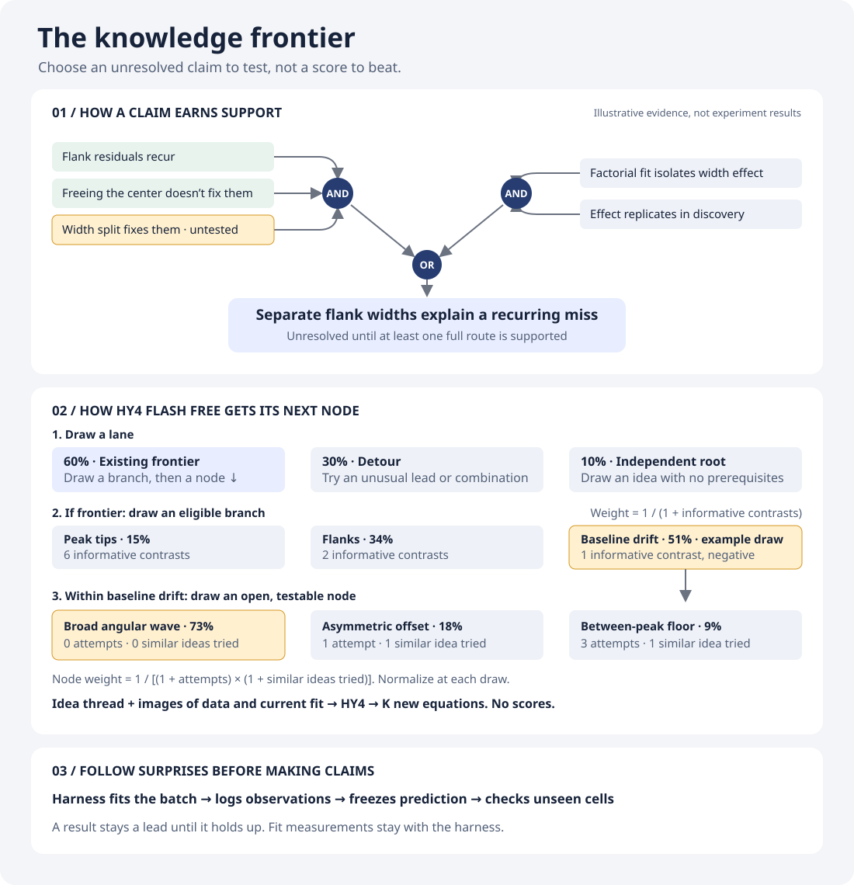

# EDGAR knowledge-frontier pilot

**Question:** Can `hy4-flash-free` learn which equation changes fix recurring errors in neural tuning curves when its next task is chosen by a gap in knowledge rather than a score ranking?

The pilot is separate from the existing EDGAR loop. Start with the double Gaussian, judge fit across the whole curve, and report regional improvements and regressions separately. The pilot tests a workflow; it cannot establish that this search strategy is better than EDGAR.

## 1. Represent claims and evidence separately

Use a directed hypergraph: each route stores a set of prerequisite claim IDs and one conclusion ID. All prerequisites in a route must be supported (**AND**); any supported route is sufficient (**OR**). Validate acyclicity on the graph formed by expanding routes into prerequisite-to-conclusion arcs. Unobserved premises are not assumptions.

- **Claims** are falsifiable and scoped: “On this discovery cohort, separate widths correct the main peak's flank error beyond what a free center can explain.” Claims without incoming routes can be tested directly. Derived claims are evaluated from their routes, not marked supported by the model.
- **Tests** are evidence records, not prerequisite edges. Store the equation or controlled variant, the prediction, the discovery split and comparator, the affected angle regions, fit diagnostics, and a verdict: supported, contradicted, or inconclusive. A failed fit is inconclusive; mixed evidence stays unresolved. A contradicted prerequisite blocks that route, not every route to its conclusion.
- **Branches** are stable scheduling groups, initially peak tips, flanks, second-peak placement, and baseline. Admit a branch to the pilot only if an observed residual motivates it. Archive previous EDGAR results as context unless they supply a controlled comparison under the same protocol.

For example, a flank-asymmetry claim could be supported by three separate findings: a recurring signed flank pattern, persistence when the peak center is freed, and a width-split improvement without meaningful regression elsewhere. An alternative route could instead use a controlled factorial fit to establish the isolated contribution of width asymmetry together with replication on a second discovery cohort. The diagram shows hypothetical evidence, not run results.

## 2. Schedule the shallowest testable gaps

Measure **evidence depth** per branch as the number of distinct, completed, interpretable contrasts, including negative results. Graph depth is separate. Refits of the same contrast, near-duplicate parameter tweaks, and failed executions do not add depth. Replications can strengthen confidence without counting as a new contrast.

For 12 proposal attempts, reserve 8 for coverage and up to 4 for confirmation or distinguishing competing explanations. For coverage, choose an eligible branch with the lowest evidence depth; break ties by oldest last attempt, then stable ID. Within it, present open prerequisites the agent can test with discovery data. If a route is contradicted, seek a materially different test or route. If nothing remains testable, log why and move on. All attempts consume a slot, including invalid proposals; spread failed attempts across branches rather than looping on one. Stop early if no informative tests remain.

Give `hy4-flash-free` the relevant subgraph, initial or current comparator curves, signed residuals and prior test outcomes. Ask it to name one gap, propose an equation contrast, and predict what the contrast should change and what should stay unchanged. No global score ranking goes into the prompt or scheduler. The model may suggest new nodes or routes; the harness validates them before adding them.

## 3. Run and evaluate the pilot

1. **Build the map and scheduler first.** Use versioned JSON and a testable map/scheduler module under `src/edgar_study/`. Write offline tests for AND/OR semantics, cycle rejection, blocked routes, duplicate contrasts, and shallow-branch selection even after a negative result. Verify that changing numeric fit rankings alone cannot change scheduling.
2. **Build the discovery-only experiment adapter.** Reuse existing dataset splits and fitting code. Start with a small declarative library of tuning-curve terms and modifiers; compile validated proposals locally rather than executing arbitrary generated Python. Freeze the discovery cohort, trial split, angle windows, fitting budget, and evidence rules before calling the model. Compute paired residual changes on held-out discovery trials for the nominated region and the whole curve. On discovery, judge whether the targeted change helped without moving the error elsewhere.
3. **Exercise the whole loop offline.** Use a synthetic fixture with a planted residual pattern and a stub model. Check that the known contrast supports its target claim, an irrelevant contrast does not, and selection and locked-test data are unavailable to the agent.
4. **Then run the free pilot.** Seed the map from a fixed discovery diagnostic panel, run at most 12 proposals with `hy4-flash-free`, and log every scheduling decision and update. Freeze the shortlist and selection rule before opening selection cells; use the locked test once for the selected equation versus the double Gaussian. Report regional and full-curve fit and complexity separately.

**Deliverables:** the versioned knowledge map, a readable graph of supported and unresolved claims, the test log, and a shortlist of equations with evidence for what each fixes. Pilot success means the map explains why tests were chosen, shallow branches receive attention regardless of early fit results, and the evidence supports or narrows claims. Finding a better equation is a result to report, not a condition for calling the pilot informative.
